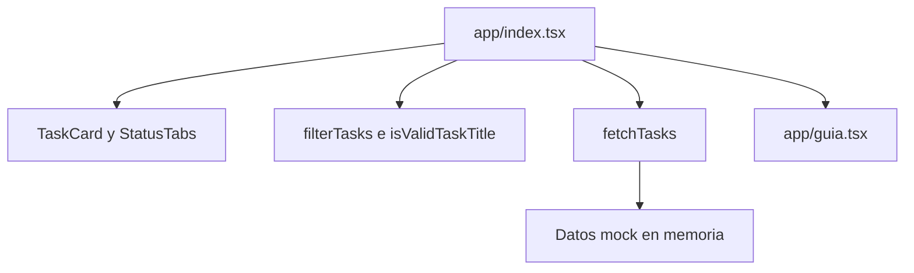

# Arquitectura

Aplicación React Native con Expo Router y TypeScript, organizada por responsabilidades.

| Módulo | Responsabilidad |
|---|---|
| app/_layout.tsx | Configuración de navegación. |
| app/index.tsx | Pantalla principal, estado, eventos y carga. |
| app/guia.tsx | Consigna del laboratorio. |
| src/components/ | Tarjetas y pestañas reutilizables. |
| src/utils/ | Filtrado y validación de títulos. |
| src/services/taskService.ts | Consulta simulada y errores. |
| src/types/task.ts | Contratos Task, TaskStatus y TaskPriority. |
| __tests__/ | Pruebas de utilidades y componente. |

## Flujo de datos
Al montar la pantalla, `useEffect` inicia `loadTasks`, que consulta `fetchTasks`. `useState` conserva tareas, búsqueda, filtro, carga, error y mensajes. `useMemo` calcula las tareas visibles a partir de `tasks`, `query` y `status`. Las tarjetas reciben datos y callbacks; el cambio de estado genera un arreglo nuevo con `map()`. La lista usa el ID de cada tarea como clave estable. `finally` finaliza el indicador de carga cuando termina la consulta.

Las operaciones de agregar, eliminar y completar son locales. Una recarga sustituye el arreglo por los datos iniciales; no hay persistencia.
